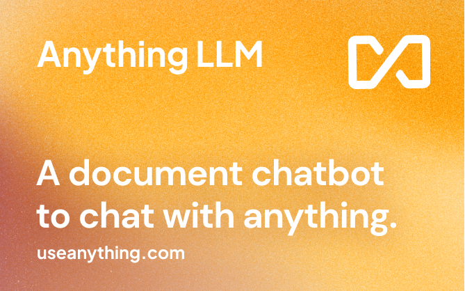
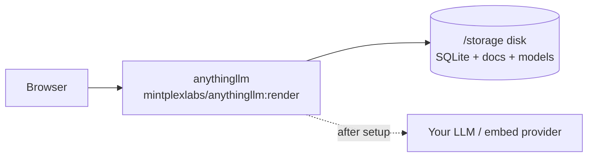

<div align="center">

# AnythingLLM on Render

Deploy **AnythingLLM**, the all-in-one private AI workspace for documents, chat, agents, and RAG, on Render with Mintplex's official `:render` image and a persistent disk.

<p>
  <a href="https://render.com/deploy-template/api/github/start?template_repo=anything-llm-render-template">
    
  </a>
</p>

<p>
  <a href="https://render.com">
    
  </a>
  <a href="https://github.com/Mintplex-Labs/anything-llm">
    
  </a>
  <a href="https://hub.docker.com/r/mintplexlabs/anythingllm">
    
  </a>
  <a href="https://docs.anythingllm.com">
    
  </a>
</p>

</div>



## What This Template Shows

This repo packages Mintplex's Render-ready Docker image as a one-click Render Blueprint:

| Piece | Role |
| --- | --- |
| **[AnythingLLM](https://github.com/Mintplex-Labs/anything-llm)** | Private AI workspace: RAG, agents, multi-user chat, 130+ providers |
| **[mintplexlabs/anythingllm:render](https://hub.docker.com/r/mintplexlabs/anythingllm)** | Official image built for Render (UI + API + collector) |
| **[Render Web Service](https://render.com/docs/web-services)** | Runs the image on a Standard instance |
| **[Render Disk](https://render.com/docs/disks)** | Persists SQLite, documents, models, and vector cache at `/storage` |

No monorepo build on Render. LLM API keys are configured in the AnythingLLM UI after first login.

## Architecture



### How It Works

1. Click **Deploy to Render**. Render forks this template into your GitHub account and applies [`render.yaml`](./render.yaml).
2. Render pulls `mintplexlabs/anythingllm:render-1.15.0`, mounts a 10 GB disk at `/storage`, and starts the container on port `3001`.
3. Open the `*.onrender.com` URL and create the admin account.
4. In **Settings → LLM Preference**, connect OpenAI, Anthropic, Gemini, Ollama, OpenRouter, or another supported provider.
5. Upload documents and chat. Data stays on the disk across deploys.

| Resource | Type | Plan | Notes |
| --- | --- | --- | --- |
| `anythingllm` | Web (`runtime: image`) | **standard** | Official Render image; health check `/api/ping` |
| `anythingllm-storage` | Disk (10 GB) | — | Mounted at `/storage` (`STORAGE_DIR`) |

Default region: **oregon**. This layout uses **SQLite on disk**, matching Mintplex's upstream [`render` branch Blueprint](https://github.com/Mintplex-Labs/anything-llm/blob/render/render.yaml). It is not a managed Postgres stack.

## Quick Start

### Prerequisites

- A [Render account](https://dashboard.render.com/register?utm_source=github&utm_medium=referral&utm_campaign=ojus_demos&utm_content=readme_link)
- An LLM provider key when you are ready to chat (not required at Apply time)

### Deploy

1. Click **Deploy to Render** above and fork into your GitHub account.
2. On Apply, confirm the `anythingllm` service and `anythingllm-storage` disk. Leave `AUTH_TOKEN` blank unless you want an instance-wide password gate.
3. Wait until the service is **Live** (~3–8 minutes; first image pull can take longer).
4. Open the public URL and finish first-time setup.
5. Connect an LLM provider in the UI, upload a document, and start a workspace chat.

Health check:

```bash
curl -sS https://<your-service>.onrender.com/api/ping
```

## Features

| Feature | Description |
| --- | --- |
| **Official Render image** | Uses Mintplex's maintained `render` / `render-*` tags |
| **One-click Blueprint** | Web service + disk via `projects` / `environments` |
| **Persistent workspace** | SQLite DB, documents, models, and vector cache on disk |
| **Provider-flexible** | Configure models in the UI after deploy |
| **Generated secrets** | `JWT_SECRET`, `SIG_KEY`, and `SIG_SALT` created on first deploy |
| **Pinned by default** | Image set to `render-1.15.0`; bump deliberately |

## Configuration

| Variable | Source | Description |
| --- | --- | --- |
| `PORT` | Blueprint | `3001` (image listen port) |
| `STORAGE_DIR` | Blueprint | `/storage` (must match the disk mount) |
| `JWT_SECRET` | Auto-generated | Session / JWT seeding |
| `SIG_KEY` | Auto-generated | Signing key |
| `SIG_SALT` | Auto-generated | Signing salt |
| `AUTH_TOKEN` | Optional (`sync: false`) | Instance-wide password gate; leave empty for UI auth only |

LLM keys (`OPEN_AI_KEY`, Anthropic, Gemini, etc.) are normally set in the UI. Env injection is documented upstream in [docker/.env.example](https://github.com/Mintplex-Labs/anything-llm/blob/master/docker/.env.example) and [docs.anythingllm.com/configuration](https://docs.anythingllm.com/configuration).

### Pin or float the image

```yaml
# render.yaml
image:
  url: docker.io/mintplexlabs/anythingllm:render-1.15.0
  # floating Render channel:
  # url: docker.io/mintplexlabs/anythingllm:render
```

`autoDeployTrigger: off` so tag or Blueprint edits do not redeploy until you choose **Manual Deploy**.

## Cost

| Resource | Approx. monthly |
| --- | ---: |
| Web service (Standard) | ~$25 |
| Disk (10 GB) | ~$2.50 |
| **Total** | **~$27–30** |

LLM tokens are billed by your provider. Do not drop the web plan to **Starter (512 MB)**: the process typically OOMs and Render reports "No open ports detected."

## Troubleshooting

| Problem | Solution |
| --- | --- |
| Health check fails / no open ports | Use **Standard** (or higher). Confirm `PORT=3001` and disk mounted at `/storage`. |
| `Reached heap limit` | Undersized instance. Keep Standard+. |
| Image pull failures | Confirm the tag exists on [Docker Hub](https://hub.docker.com/r/mintplexlabs/anythingllm/tags). Retry the deploy. |
| Data lost after redeploy | Disk must remain attached at `/storage`. Snapshot before destructive changes. |
| Login / session weirdness after secret rotate | Do not casually rotate `JWT_SECRET` / `SIG_*` after users exist. |

## Project Structure

```
render.yaml       Render Blueprint (image + disk)
README.md         This file
LICENSE           MIT (template wrapper)
.env.example      Optional env overrides
assets/           Hero / logo placeholders
```

## Learn More

**Render:**
- [Web Services](https://render.com/docs/web-services)
- [Disks](https://render.com/docs/disks)
- [Blueprints](https://render.com/docs/infrastructure-as-code)
- [Deploy to Render button](https://render.com/docs/deploy-to-render-button)

**AnythingLLM:**
- [Documentation](https://docs.anythingllm.com)
- [GitHub](https://github.com/Mintplex-Labs/anything-llm)
- [Upstream Render Blueprint](https://github.com/Mintplex-Labs/anything-llm/blob/render/render.yaml)
- [Docker Hub](https://hub.docker.com/r/mintplexlabs/anythingllm)

## License

[MIT](LICENSE) for this template wrapper.

Upstream [AnythingLLM](https://github.com/Mintplex-Labs/anything-llm) is also MIT. Star that repo if this helped.
